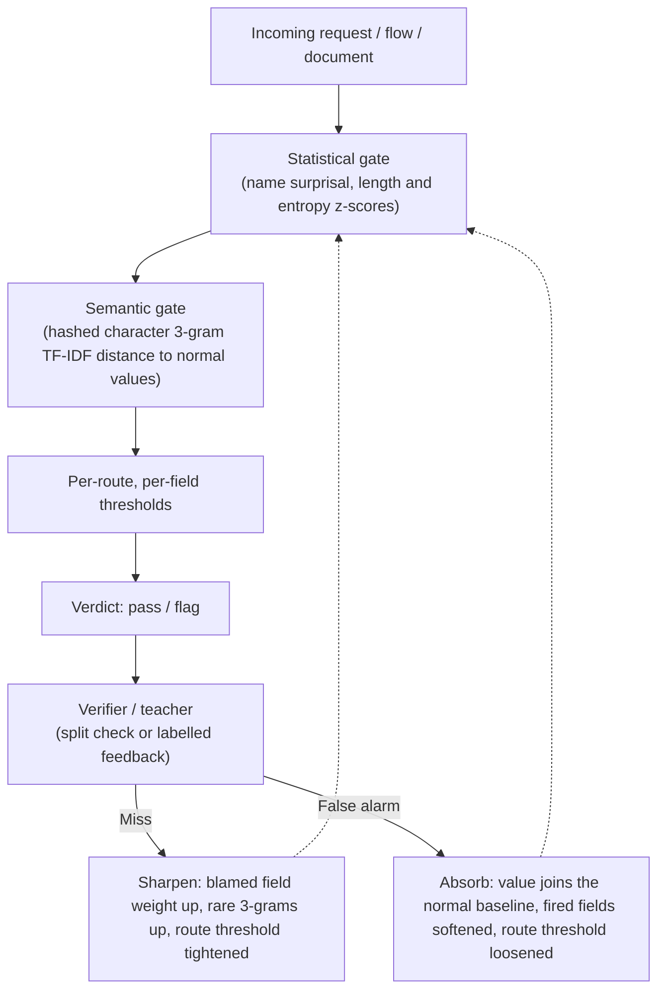

# SSE (Semantic Split Entropy Gating): Benchmarks

Compiled 2026-10-21. All measured benchmarks for SSE in three settings:
1. **Network intrusion detection**: `ids/sse_ids.py` on CIC-IDS2017 (Part I)
2. **Information retrieval**: `retrieval/sse_retrieval.py` on SciFact and NQ-100k (Part II)
3. **HTTP web-attack detection**: the `sse/` gates on SR-BH 2020 (907k real honeypot requests) and CSIC 2010 (Part III)

---

## 0. Technical Specification

### Requirements & Dependencies
| Component | Requirements |
|---|---|
| **Runtimes** | Python 3.10+ (tested on Windows and Linux) |
| **Dependencies** | Python + `numpy` (`anomaly_model.py` and `calibration.py` use the standard library only). `scipy` for the NQ benchmark; `bqboost` for the retrieval benchmarks' dense / binary-quantised baselines. No PyTorch, no CUDA, no GPU. |
| **Training Requirement** | Normal traffic only. No attack labels needed to fit. |
| **Supervision / Ground Truth** | **HTTP:** a verifier's verdict on each wrong decision (the dataset label in these benchmarks, standing in for the split verifier). **IDS:** no ground-truth labels at runtime (Part-B temporal response verifier). **IR:** self-supervised document splitting, or optional relevance pairs. |

### Memory & Size
| Implementation | Code Size | In-Memory / Serialized State Size |
|---|---|---|
| **SSE gates (`sse/`)** | 384 lines (`anomaly_model.py`: 118, `semantic_model.py`: 193, `calibration.py`: 73); the gates recalibrate themselves from failures (Part III) | SR-BH: 16–98 MB fitted 3-gram matrices; trained scanner 95–105 MB after one lap, ~490 MB after five belt laps |
| **Network IDS (`sse_ids.py`)** | 560 lines | **1.78 MB – 1.85 MB** (measured via pickle on 120k flow stream) |
| **Converted IR (`sse_retrieval.py`)** | 765 lines | **14.2 MB** on SciFact 5k corpus; **333.3 MB** on NQ-100k corpus (uncompressed sparse matrix) |

### Architecture Overview

### Measured Processing Speed
| Module | Training / Fit Time | Per-Item Processing Latency | Measured Throughput |
|---|---|---|---|
| **Network IDS (Closed Loop)** | 2.16 s – 2.98 s (on 36k benign flows) | **91.9 µs – 189.1 µs / flow** | **5,287 – 10,883 flows / s** (single CPU thread) |
| **HTTP gates (SR-BH)** | 10–28 s (on 10k normal requests) | **1.25 ms / request** frozen; ~1.1–1.4 ms while learning | ~700–900 requests / s (single CPU thread) |
| **Converted IR (SciFact 5k)** | Pre-indexed | Gate: **1.28 ms** p50, Semantic: **3.18 ms** p50 | ~315 queries / s |
| **Converted IR (NQ 100k)** | Build: 74.5 s total | Gate: **2.99 ms** p50, Semantic: **8.09 ms** p50 | ~120 queries / s |

---

# PART I: NETWORK IDS BENCHMARKS (CIC-IDS2017)

**Source:** Official CIC-IDS2017 CSVs (`c01dsnap/CIC-IDS2017`), evaluated in `benchmark_sse_cic.py`.
**Training setup:** 36,000 calm benign flows per dataset. Zero attack labels used during fit or streaming evaluation.

### 1.1 Full Closed-Loop Detection Performance (Pass 1)
| Dataset / Scenario | Stream Size (Benign / Attack) | Precision | Recall (TPR) | FPR | F1 Score | Accuracy | Gate / Split Event Counts |
|---|---|---|---|---|---|---|---|
| **Friday DDoS** | 39,031 / 80,969 | 0.9822 | **0.9995** | 0.0376 | **0.9908** | 0.9874 | `G:31,840` `S:1,411` `Cal:48,732` `Sp:410` |
| **Friday PortScan** | 43,863 / 76,137 | 0.9743 | **0.9995** | 0.0457 | **0.9867** | 0.9830 | `G:76,067` `S:1,322` `Cal:383` `Sp:331` |
| **Wednesday DoS & Multi-Attack** | 73,847 / 46,153 | 0.9071 | **0.9813** | 0.0628 | **0.9428** | 0.9542 | `G:1,378` `S:28,969` `Cal:19,003` `Sp:576` |
| **Thursday Web Attacks** | 118,046 / 1,954 | 0.0181 | 0.0455 | 0.0410 | 0.0259 | 0.9442 | `G:2,339` `S:710` `Cal:1,165` `Sp:710` |

*G: Caught by EntropyGate, S: Caught by SemanticSpace, Cal: Caught by Front Gate via Split blame signatures, Sp: Caught by SplitVerifier.*

### 1.2 Per-Attack Recall Progression Across Stages
*Demonstrates how misses slipping past Part-A front gates trigger Split and teach the Front Gate in real time:*

| Attack Class | Test Flow Count | Unfixed SSE (Original Port) | Part-A Gates Alone | Full Closed-Loop SSE (Pass 1) | Warmed Front Gate (Pass 2) |
|---|---|---|---|---|---|
| **DDoS** | 80,969 | 0.0% | 39.9% | **99.9%** | 100.0% |
| **PortScan** | 76,137 | 0.0% | 99.8% | **99.9%** | 100.0% |
| **DoS Hulk** | 42,204 | 0.0% | 64.5% | **98.9%** | 99.4% |
| **DoS GoldenEye** | 1,864 | 0.0% | 6.7% | **78.5%** | 89.4% |
| **DoS Slowhttptest** | 1,009 | 10.9% | 72.4% | **99.2%** | 99.2% |
| **DoS slowloris** | 1,074 | 1.2% | 92.5% | **99.3%** | 99.5% |
| **Heartbleed** | 2 | 100.0% | 100.0% | **100.0%** | 100.0% |
| **Web Brute Force** | 1,354 | 4.9% | 5.2% | **5.2%** | 5.2% |
| **Web XSS** | 582 | 2.2% | 2.9% | **2.9%** | 2.9% |
| **Web SQL Injection** | 18 | 0.0% | 5.6% | **11.1%** | 11.1% |

### 1.3 Ablation: Unfixed Bugs vs. Fixed Architecture (F1 Comparison)
| Scenario | Unfixed Gates (Digit Folding) | Unfixed + Scalar Cal (`z - 0.25`) | Fixed Gate A Only | Fixed Gate A + B | Fixed Full Loop |
|---|---|---|---|---|---|
| **Friday DDoS** | 0.0000 | 0.8737 *(FPR: 59.9%)* | 0.5585 | 0.5652 | **0.9908** |
| **Friday PortScan** | 0.0000 | 0.2880 *(FPR: 79.2%)* | 0.9836 | 0.9899 | **0.9867** |
| **Wednesday DoS** | 0.0052 | 0.6066 *(FPR: 81.1%)* | 0.0226 | 0.7599 | **0.9428** |
| **Thursday Web** | 0.0507 | 0.0390 *(FPR: 81.5%)* | 0.0042 | 0.0352 | **0.0259** |

---

# PART II: CONVERTED RETRIEVAL BENCHMARKS (IR / RAG)

**Source:** `sse_scifact_results.json`, `sse_finetuned_results.json`, `sse_nq100k_results.json`.

### 2.1 Domain-Specific Technical Corpus: BEIR SciFact (5,183 Docs, 300 Test Queries)
*SciFact contains heavy biomedical and biochemical acronyms/jargon.*

| Method | Type / Architecture | Model Weights | nDCG@10 | Recall@10 | MRR@10 | Latency (p50) |
|---|---|---|---|---|---|---|
| **Dense MiniLM-L6** | Neural Embedding (`all-MiniLM-L6-v2`) | 87 MB | 0.6451 | 0.7833 | 0.6047 | 1.45 ms |
| **BQ Sign + Rescore100** | 1-bit Compressed Vector (`bqboost`) | 0.2 MB codes | 0.6426 | 0.7733 | 0.6049 | **0.26 ms** |
| **SSE EntropyGate** | Lexical BM25 Variant ($k_1=1.2, b=0.75$) | 0 MB | 0.6564 | 0.7782 | 0.6211 | 1.28 ms |
| **SSE SemanticSpace 16k** | Hashed char 3-gram + word TF-IDF | 0 MB | **0.6762** | 0.8014 | 0.6423 | 3.18 ms |
| **SSE + Split Zero-Shot** | Title/Lead vs Body check | 0 MB | 0.6711 | 0.8008 | 0.6359 | 5.99 ms |
| **SSE + Calibrated Zero-Shot** | Online Split decoy adjustment | 0 MB | 0.6697 | 0.7914 | 0.6369 | 7.20 ms |
| **SSE Supervised Fine-Tuned** | Learned term gains & bridge links (809 queries) | 0 MB | **0.7190** | 0.8155 | 0.6968 | 7.20 ms |
| **BQ Rescore100 + SSE-ft** | Hybrid Fusion (Dense 1-bit + SSE lexical) | 87 MB (dense) | **0.7365** | **0.8462** | **0.7074** | 11.08 ms |

*Finding:* Plain `SemanticSpace 16k` (0.6762) outperforms MiniLM (0.6451) zero-shot on biomedical terminology. Document splitting and self-calibration do not help zero-shot retrieval (drops from 0.6762 to 0.6697).

### 2.2 Open-Domain Natural Language QA: Natural Questions (100,000 Passages, 3,452 Queries)
*NQ consists of broad Wikipedia passages and natural queries requiring semantic abstraction.*

| Method | Index Footprint | Build Time | nDCG@10 | Recall@10 | MRR@10 | Latency (p50) |
|---|---|---|---|---|---|---|
| **Dense MiniLM (Exact)** | 146 MB float32 | — | **0.8413** | **0.9469** | **0.8163** | 6.23 ms |
| **`hada_r0.95` (`bqboost`)** | **4.6 MB** binary | 1.43 s | **0.8407** | 0.9458 | 0.8159 | **0.40 ms** |
| **Standard BM25** | 38 MB index | 24.2 s | 0.6597 | 0.7911 | 0.6334 | 3.08 ms |
| **SSE EntropyGate** | 42 MB index | 40.8 s | 0.6682 | 0.8052 | 0.6373 | 2.99 ms |
| **SSE SemanticSpace 3-gram** | 333.3 MB index | 33.7 s | 0.5723 | 0.7641 | 0.5199 | 8.09 ms |
| **Dense + BM25 (Hybrid)** | 184 MB | — | 0.8313 | 0.9387 | 0.8076 | 9.46 ms |
| **Dense + SSE Semantic** | 479 MB | — | 0.7755 | 0.9255 | 0.7342 | 14.44 ms |

*Supervised Fine-Tuning on NQ (1,726 train / 1,726 held-out queries):*
- Before: `0.6666` nDCG@10
- After: `0.6694` nDCG@10 (+0.0028 gain, 95% CI `[-0.003, +0.018]`, statistically insignificant).
*Finding:* On natural language paraphrases, 3-gram TF-IDF is ineffective (0.5723 vs 0.8413) and degrades dense retrieval when blended (0.8413 $\to$ 0.7755).

---

# PART III: HTTP WEB-ATTACK IDS (SR-BH 2020)

**Dataset:** SR-BH 2020 (Harvard Dataverse `doi:10.7910/DVN/OGOIXX`, *Computers & Security* 120, 2022): 907,813 real HTTP requests to a WordPress honeypot exposed for 12 days, 525,193 normal and 382,620 anomalous, 13 CAPEC classes (SQL injection alone: 250,311). Labels come from ModSecurity CRS with manual review, so they are not rule-independent ground truth. Every attack falls on 17–19 Jul 2020; 20–29 Jul is normal traffic only.
**Code:** the `sse/` gates. Harness: `harness/` (`run_sse_srbh.py`, `replay_recal.py`, `replay_realtime.py`, `replay_twice.py`, `replay_learn.py`, `belt.py`, `csic_*.py`). Response columns (status code, length) are never read.
**Fields:** *stock* = headers + parameter names only; *+fields* = also `@method`, `@path`, `@query`, `@body` scored as values by both gates (same algorithm, more inputs).
**Teacher for all learning rows:** the dataset label, standing in for the split verifier's verdict. In deployment the verifier confirms only a subset of wrong verdicts, so learning from every one is the upper bound of what the loop can do.

### 3.1 Zero-Shot (no learning, fit on benign only)
*Held-out requests from 17–19 Jul (20,000 benign / 21,881 attacks), gates fit on 10,000 benign from the same window. Detection at a fixed false-alarm rate on held-out benign.*

| Setup | ROC-AUC | Detection @ 1% FPR | Detection @ 5% FPR | At its own thresholds (TPR / FPR) | p50 latency | Semantic memory |
|---|---|---|---|---|---|---|
| URI + body length (no model, floor) | 0.713 | 17.0% | 35.5% | — | — | — |
| SSE stock (headers + param names) | 0.629 | 6.5% | 11.0% | 10.0% / 1.7% | 1.37 ms | 32.2 MB |
| SSE +fields, both gates | 0.860 | 12.7% | 38.6% | 26.3% / 1.5% | 1.74 ms | 97.7 MB |
| SSE +fields, semantic gate alone | **0.885** | **23.8%** | **59.6%** | — | — | — |

*Time-disjoint variant (fit on 20–29 Jul benign, test 17–19 Jul):* drift breaks the shipped thresholds (the cascade flags 92.5% of normal requests stock, 98.1% +fields; AUC 0.64 / 0.69). The gates need a baseline from the period they guard.

### 3.2 Real-Time Recalibration on Every Wrong Verdict (traffic never seen)
*Precalibrated on 17 Jul (150,710 requests), then a time-ordered replay of 18–19 Jul: 384,629 requests, 266,246 attacks. Same split and seed for every row. Mid-18 Jul, normal traffic changes; static false alarms jump from ~9% to ~52%.*

| Detector | What feedback changes | Detection | False alarms | Precision | Wrong verdicts |
|---|---|---|---|---|---|
| Static (+fields, shipped 1% thresholds) | nothing | 55.9% | 59.4% | 67.9% | 187,858 |
| Tighten-only, 120 s half-life (previous `calibration.py`) | route threshold, misses only, decays | 61.6% | 62.7% | 68.8% | 176,403 |
| Precalibrated thresholds, frozen | — | 58.4% | 60.5% | 68.5% | 182,409 |
| Real-time thresholds, cold start | route threshold: misses tighten, false alarms loosen, no decay | 65.5% | 39.0% | 79.1% | 138,055 |
| Real-time thresholds, precalibrated | same | 65.7% | 39.0% | 79.1% | 137,358 |
| **Gates learn** | **the gates' own weights and benign store** | **68.0%** | **5.7%** | **96.4%** | **91,950** |
| **Gates learn + route thresholds** | both | **76.7%** | **5.1%** | **97.1%** | **67,953** |

*Gate learning cuts mistakes by 33% (gates only) and 51% (with route thresholds) against threshold-only recalibration, and false alarms from 39.0% to 5–6%. After lap 1 the gates-only scanner had folded 7,643 requests into the statistical baseline, stored 4,908 values as normal and boosted 8,145 rare 3-grams; the hybrid also holds 171,034 route overrides (threshold-only: 354,785). A single gate update flips the same request's verdict only 6.2% of the time (small steps); the route override always does (100%).*
*An earlier attempt crashed out of memory near the end: the benign-store merge (`HeaderSpace._rows`) kept a full temporary copy alive per row. Fixed with `_merge`, which concatenates block arrays (lookups match brute force to 6e-8).*
*Threshold-only real-time verified every one of its 137,358 corrections (re-checking the same request flips its verdict, 0 failures). Its weakness is scope: 66% of SR-BH attack paths never repeat, and each false alarm loosens a single path, so the 18 Jul shift stays at ~35% false alarms. Gate learning absorbs it (3.7%) because a false alarm teaches every route what normal looks like.*

**Precalibration day (17 Jul, 150,710 requests):**

| Detector | Detection | False alarms | Wrong verdicts |
|---|---|---|---|
| Real-time thresholds | 41.9% | 2.2% | 68,350 |
| Gates learn | 68.8% | 2.6% | 37,152 |
| Gates learn + route thresholds | **80.3%** | 2.7% | **23,835** |

### 3.3 Per-Class Detection (18–19 Jul replay)

| CAPEC class | Static (59.4% FPR) | Real-time thresholds (39.0% FPR) | Gates learn (5.7% FPR) | Gates learn + route (5.1% FPR) |
|---|---|---|---|---|
| 66 SQL Injection | 50.6% | 61.5% | 71.3% | **78.4%** |
| 126 Path Traversal | 54.1% | **97.6%** | 27.5% | 86.2% |
| 194 Fake the Source of Data | **98.4%** | 67.7% | 63.7% | 81.8% |
| 34 HTTP Response Splitting | 58.5% | **62.7%** | 31.9% | 42.5% |
| 242 Code Injection | 93.5% | **94.2%** | 88.1% | 90.0% |
| 272 Protocol Manipulation | 80.3% | **90.9%** | 34.9% | 65.8% |
| 88 OS Command Injection | 70.5% | 92.1% | 45.5% | **98.3%** |
| 33 HTTP Request Smuggling | 93.0% | 70.3% | 57.2% | **93.6%** |
| 153 Input Data Manipulation | 94.2% | **99.3%** | 97.1% | 99.0% |
| 16 Dictionary-based Password Attack | 99.7% | 99.5% | **99.8%** | 97.4% |
| 274 HTTP Verb Tampering | **100.0%** | 94.2% | **100.0%** | 99.9% |
| 310 Scanning for Vulnerable Software | **100.0%** | **100.0%** | **100.0%** | **100.0%** |

*Columns are not at equal false-alarm rates: static and threshold-only per-class figures are inflated by flagging 39–59% of normal traffic. Gates-only is weakest where misses must teach (path traversal, protocol manipulation, response splitting): a miss moves only one field by 5%.*

### 3.4 Speed and Size
| Item | Value |
|---|---|
| Fit | 10–28 s on 10,000 benign requests |
| Per request, frozen gates (+fields) | 1.25 ms profiled; 1.4–2.8 ms p50 in the replays |
| Per request, gates learning (after the fixes) | ~0.3 ms precalibration, ~1.1–1.4 ms over 18–19 Jul (lap 1: 470–620 s for 384,629 requests) |
| Trained scanner after lap 1 (pickle) | 94.9 MB gates only, 105.4 MB with route overrides (mostly the semantic matrices) |
| Real-time threshold table after 18–19 Jul | 354,785 overrides, 28.8 MB pickled (one entry per request seen: memorisation) |
| Speed fixes, 2026-10-21 | per-value cache of `grams`/`unique` and `shannon`; pending store searched as one block; versioned per-field distance cache; block merge without per-row copies. 16× faster end to end (15 s vs 244 s per 50k requests), identical verdicts on a 6,000-request learning check |

### 3.5 Conveyor Belt: Same Scanner, Same Belt, Calibrating Every Lap (convergence check)
*The scanner saved at the end of lap 1 (3.2) keeps scanning the identical 18–19 Jul stream (384,629 requests) and keeps learning from every wrong verdict (`belt.py`). This measures convergence and retention on traffic it has already seen; it is not a benchmark on unseen traffic (Part IV, item 7). Lap 1 is the unseen-traffic figure.*

| Lap | Gates + route: detection | False alarms | Precision | Wrong verdicts | Gates only: detection | False alarms | Wrong verdicts |
|---|---|---|---|---|---|---|---|
| 1 (unseen) | 76.7% | 5.1% | 97.1% | 67,953 | 68.0% | 5.7% | 91,950 |
| 2 | 85.6% | 3.3% | 98.3% | 42,265 | 44.7% | 1.7% | 149,274 *(stopped: worse)* |
| 3 | 96.4% | 2.9% | 98.7% | 12,954 | — | — | — |
| 4 | 97.1% | 2.6% | 98.9% | 10,723 | — | — | — |
| 5 | **98.4%** | **2.4%** | **98.9%** | **7,011** | — | — | — |
| 6 | 98.2% | 2.5% | 98.9% | 7,775 *(stopped: no gain)* | — | — | — |

*The hybrid converges and plateaus at lap 5 (98.4% / 2.4%): mistakes fall 90% from lap 1, and lap 6 adds nothing. A deterministic regeneration from the lap-1 snapshot reproduced laps 2 and 3 exactly (42,265 and 12,954 wrong verdicts); per-lap snapshots (`belt_gates_learn_route_lap<N>.pkl`, 300–500 MB each) are not included; `harness/belt.py` regenerates them. Gates-only diverges: false alarms teach strongly (value stored as normal, fired fields' weights cut) while a miss nudges one field by 5%, so each lap drains sensitivity (detection 68.0% → 44.7%). The route overrides supply the strong per-miss correction the gates lack; balancing the two updates is the main design fix left (3.8).*

### 3.6 Cross-Site Transfer: CSIC 2010 (a different web app)
*CSIC 2010: 61,065 test requests to a Spanish e-shop (36,000 normal, 25,065 attacks), seeded random order (no timestamps), mapped onto the SR-BH field schema. One lap each, learning from every wrong verdict (`csic_lap.py`).*

| Scanner | Normal-traffic baseline | Mode | Detection | False alarms | Precision | Wrong verdicts |
|---|---|---|---|---|---|---|
| Brand-new hybrid | CSIC normal training (10,000) | frozen | 61.2% | 1.1% | 97.5% | 10,119 |
| **Brand-new hybrid** | CSIC normal training (10,000) | **one learning lap** | **87.8%** | **9.7%** | **86.4%** | **6,542** |
| SR-BH hybrid, lap-1 snapshot | SR-BH (WordPress) | frozen | 100% | **100%** | 41.0% | 36,000 |
| SR-BH hybrid, lap-1 snapshot | SR-BH (WordPress) | one learning lap | 71.9% | 24.5% | 67.1% | 15,873 |
| SR-BH hybrid, lap-3 snapshot | SR-BH (WordPress) | frozen | 100% | **100%** | 41.0% | 36,000 |
| SR-BH hybrid, lap-3 snapshot | SR-BH (WordPress) | one learning lap | 74.2% | 17.9% | 74.3% | 12,902 |
| SR-BH lap-3, **rebaselined** (gains + weights) | CSIC normal training (10,000) | frozen | 63.6% | 1.0% | 97.7% | 9,507 |
| SR-BH lap-3, **rebaselined** (gains + weights) | CSIC normal training (10,000) | one learning lap | 86.9% | 10.2% | 85.6% | 6,956 |
| SR-BH lap-3, rebaselined (3-gram gains only) | CSIC normal training (10,000) | frozen / lap | 63.6% / 87.5% | 1.0% / 9.8% | 97.7% / 86.2% | 9,492 / 6,655 |
| SR-BH lap-3, rebaselined (field weights only) | CSIC normal training (10,000) | frozen / lap | 61.1% / 87.5% | 1.1% / 9.8% | 97.5% / 86.2% | 10,140 / 6,665 |

*The benign baseline does not transfer: to a WordPress-trained scanner every e-shop request is abnormal (100% false alarms frozen), and one lap of learning leaves it behind a fresh scanner (lap-3 snapshot: 74.2% / 17.9%, lap-1: 71.9% / 24.5%, fresh: 87.8% / 9.7%). More SR-BH training helps a little, but a baseline from the wrong site costs more than the training gains. A fresh SSE fitted on the new site's normal traffic learns fast (61% → 88% detection in one lap), though its false alarms rise to 9.7% on CSIC's uniform synthetic traffic. *Rebaselining (`csic_rebaseline.py`): fit fresh gates on the new site's normal traffic, copy the learned 3-gram gains and field weights, drop SR-BH statistics, stored values and route overrides, re-set thresholds at 1%. This removes the transfer failure (false alarms 100% → 1.0% frozen; mistakes after one lap 12,902 → 6,956). The carried 3-gram gains add +2.4 points of detection at the same 1% false-alarm rate before any learning (63.6% vs 61.2%); after one learning lap the advantage is gone (6,655–6,956 mistakes vs 6,542 fresh), because CSIC's own feedback overtakes the SR-BH prior within the first few thousand requests. Field weights alone carry nothing.*

**CSIC conveyor belt** (`csic_belt.py`: the same 61,065-request CSIC stream, 8 laps, learning every lap; wrong verdicts per lap, detection / false alarms in brackets):

| Lap | Brand new | SR-BH lap-3, rebaselined (3-gram gains) | SR-BH lap-3, carried over unchanged |
|---|---|---|---|
| 1 (unseen) | 6,542 (87.8% / 9.7%) | 6,655 (87.5% / 9.8%) | 12,902 (74.2% / 17.9%) |
| 2 | 5,770 | 6,027 | 11,945 |
| 3 | 5,117 | 5,243 | 7,431 |
| 4 | 4,609 | 4,739 | 3,872 |
| 5 | 4,119 | 4,261 | 2,438 |
| 6 | 3,722 | 3,803 | 1,727 |
| 7 | 3,478 | 3,290 | 1,257 |
| 8 | 3,120 (94.3% / 4.7%) | 2,937 (94.6% / 4.4%) | **975 (98.3% / 1.5%)** |

*Full per-lap figures (`csic_belt_results.json`):*

| Lap | Brand new: detection | false alarms | precision | wrong | Rebaselined: detection | false alarms | precision | wrong | Carried over: detection | false alarms | precision | wrong |
|---|---|---|---|---|---|---|---|---|---|---|---|---|
| 1 (unseen) | 87.8% | 9.7% | 86.4% | 6,542 | 87.5% | 9.8% | 86.2% | 6,655 | 74.2% | 17.9% | 74.3% | 12,902 |
| 2 | 89.9% | 9.0% | 87.5% | 5,770 | 89.3% | 9.3% | 87.0% | 6,027 | 76.5% | 16.8% | 76.0% | 11,945 |
| 3 | 90.9% | 7.9% | 89.0% | 5,117 | 90.6% | 8.0% | 88.7% | 5,243 | 86.7% | 11.4% | 84.1% | 7,431 |
| 4 | 91.7% | 7.0% | 90.1% | 4,609 | 91.4% | 7.2% | 89.9% | 4,739 | 93.8% | 6.5% | 91.0% | 3,872 |
| 5 | 92.4% | 6.2% | 91.2% | 4,119 | 92.2% | 6.4% | 90.9% | 4,261 | 96.2% | 4.2% | 94.2% | 2,438 |
| 6 | 93.1% | 5.6% | 92.1% | 3,722 | 93.0% | 5.7% | 91.9% | 3,803 | 97.2% | 2.9% | 95.9% | 1,727 |
| 7 | 93.6% | 5.2% | 92.6% | 3,478 | 94.0% | 5.0% | 93.0% | 3,290 | 97.9% | 2.0% | 97.1% | 1,257 |
| 8 | 94.3% | 4.7% | 93.3% | 3,120 | 94.6% | 4.4% | 93.7% | 2,937 | 98.3% | 1.5% | 97.8% | 975 |

*Brand new and rebaselined track each other (mistakes halve over 8 laps, ~10% per lap, not yet converged). The scanner carried over unchanged starts worst on unseen traffic but converges fastest on the repeated belt, overtaking both by lap 4. Likely cause (not yet measured): its WordPress baseline flagged nearly all CSIC traffic at first, so laps 1–3 stored most of this belt's normal values verbatim and set per-path thresholds, which then fit the repeated belt closely. Fastest fit to a belt it keeps seeing is a different property from performance on new traffic (lap 1), where it is the worst. Laps 2+ are convergence checks (Part IV, item 7).*

### 3.7 What These Results Say About SSE
1. **The self-calibrating loop is what makes it work.** The same ~400 lines go from 24% detection at 1% false alarms (frozen) to 76.7% detection at 5.1% false alarms and 97.1% precision on unseen real honeypot traffic once the gates recalibrate themselves from failures. Moving only route thresholds reached 65.7% at 39.0%.
2. **It adapts to drift on its own.** When normal traffic shifted on 18 Jul, frozen gates went to 52–59% false alarms; gate learning stayed near 4–6%, because a false alarm teaches every route what normal looks like.
3. **It converges on traffic it keeps seeing** (97.1% / 2.6% by lap 4) when misses and false alarms both teach strongly (hybrid). With gates only, the lopsided updates make it drift towards silence.
4. **Normal traffic is site-specific; learn it per site.** A scanner trained on one site is useless frozen on another. The right deployment is a fresh benign baseline per site, with learned attack knowledge carried over.
5. **Caveats.** The teacher is the dataset label (in deployment the split verifier confirms only a subset of wrong verdicts), so these are upper bounds of the loop. The trained state is 95–105 MB (dense 3-gram matrices). 5% false alarms is pre-filter grade, not blocking grade.

### 3.8 Open Items
1. Balance the updates: a miss should push as hard as a false alarm (larger miss rate, or sharpen every above-normal field), so gates-only stops draining.
2. Automatic environment detection (Host novelty / false-alarm spike) that triggers the rebaseline above.
3. Store the learned and fitted values sparsely (the matrices are ~1–2% dense) to shrink the 95–105 MB state.
4. Find what changed in 18 Jul normal traffic.

---

# PART IV: AUDIT & EXCLUSIONS RECORD

The following previously referenced numbers are explicitly excluded from verified benchmarks due to methodological contamination:

1. **SciFact "Pass 2 Confirmed Feedback" (0.7741 nDCG@10):** Contaminated by test-label leakage. The test set `qrels` were fed into `fine_tune_supervised` and re-evaluated on the identical 300 test queries.
2. **CIC-IDS2017 "Pass 2 Warmed Gates":** Replayed identical test streams after the model adapted to them in Pass 1. Retained only as an internal mechanism check; not valid as single-pass benchmark scores.
3. **WebAttacks "~86% Estimated Recall":** Single-feature diagnostic only; not a verified full-stream model run.
4. **Early CSIC 2010 Custom IDS Scripts:** Ad-hoc synthetic anomaly scripts with invalid class balancing; removed.
5. **SR-BH 2020 "Pass 2" replays (96.3% detection / 7.2% false alarms frozen; 98.9% / 4.1% learning):** the precalibrated real-time threshold instance re-run over the identical 18–19 Jul stream it had already been corrected on (354,785 overrides for 384,629 requests). Mechanism check for retention only; the single-pass figure is 65.7% / 39.0% (Part III, 3.2).
6. **Early bqboost CSIC 2010 IDS results (`test_sse_cyber_ids.py`, `train_and_test_sse_ids.py`, `cyber_data/`):** a separate re-implementation whose route tightening was added to every request on a route (44.5% false alarms after "training"); deleted by the owner.
7. **SR-BH 2020 and CSIC 2010 conveyor-belt laps 2+ (Part III, 3.5–3.6; e.g. SR-BH 98.4% / 2.4% at lap 5, CSIC 98.3% / 1.5% at lap 8):** the same scanner re-scanning the stream it has already been corrected on. Convergence and retention check only; the unseen-traffic figure is lap 1 (76.7% / 5.1%).
